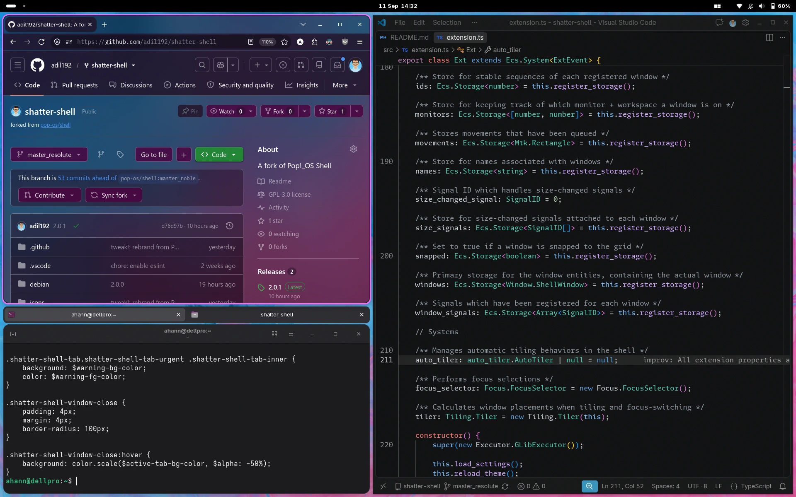

# Shatter Shell

Shatter Shell is a keyboard-driven layer for GNOME Shell which allows for quick and sensible navigation and management of windows. The core feature of Shatter Shell is the addition of advanced tiling window management — a feature that has been highly sought within our community. For many — ourselves included — i3wm has become the leading competitor to the GNOME desktop.

Tiling window management in GNOME is virtually nonexistent, which makes the desktop awkward to interact with when your needs exceed that of two windows at a given time. Luckily, GNOME Shell is an extensible desktop with the foundations that make it possible to implement a tiling window manager on top of the desktop.

Therefore, we see an opportunity here to advance the usability of the GNOME desktop to better accommodate the needs of our community with Shatter Shell. Advanced tiling window management is a must for the desktop, so we've merged i3-like tiling window management with the GNOME desktop for the best of both worlds.

[](https://raw.githubusercontent.com/adil192/shatter-shell/refs/heads/master_resolute/screenshot.webp)

## Fork notice

This is a fork of the original [pop-os/shell](https://github.com/pop-os/shell) repo,
which is no longer being developed<sup>[source](https://github.com/pop-os/shell/issues/1829#issuecomment-5511896163)</sup>.

Find a summary of this fork's main improvements in the [2.0.0 release](https://github.com/adil192/shatter-shell/releases/tag/2.0.0) and incremental improvements in the [other releases](https://github.com/adil192/shatter-shell/releases).

## Install

There are a few ways to install Shatter Shell. Expand the section that works for your system...

<details>
<summary><b>Install on  Fedora and Fedora-based distros</b></summary>

Shatter Shell is included in the [Terra](https://terrapkg.com/) community repo.

1.  Add the Terra repo if you haven't already:
    ```bash
    sudo dnf install --nogpgcheck --repofrompath 'terra,https://repos.fyralabs.com/terra$releasever' terra-release
    ```
2.  Remove the original Pop Shell if you have it:
    ```bash
    sudo dnf remove gnome-shell-extension-pop-shell
    ```
3.  Install Shatter Shell:
    ```bash
    sudo dnf install gnome-shell-extension-shatter-shell
    ```
</details>
<details>
<summary><b>Install on  Arch and Arch-based distros</b></summary>

This repo includes a PKGBUILD for Arch.

1.  Clone this repo:
    ```bash
    git clone https://github.com/adil192/shatter-shell
    cd shatter-shell
    ```
2.  Build and install:
    ```bash
    makepkg -si
    ```
</details>
<details>
<summary><b>Install on any distro from a GitHub release</b></summary>

1.  Download the zip from [the latest release](https://github.com/adil192/shatter-shell/releases/latest).
2.  Run `gnome-extensions install -f path/to/shatter-shell@adilhanney.com_*.zip`.
</details>
<details>
<summary><b>Install on any distro from source</b></summary>

To get the latest bleeding edge changes, build Shatter Shell from source:

1.  Install build dependencies, e.g.:
    ```bash
    sudo dnf install make git npm
    ```
1.  Clone this repo:
    ```bash
    git clone https://github.com/adil192/shatter-shell
    cd shatter-shell
    ```
2.  Build and install:
    ```bash
    make local-install
    ```

**Note**: Make sure to use `make local-install` NOT `make install`. The latter is intended for package maintainers and bypasses the GNOME extension installation process.
</details>
<br>

**Post-install (all methods)**:
After installing with one of the above methods, you need to log out and back in.
Then enable the extension in [Extension Manager](https://flathub.org/en/apps/com.mattjakeman.ExtensionManager).
Alternatively, run `gnome-extensions enable shatter-shell@adilhanney.com` in a terminal.

## Uninstall

Remove the extension with [Extension Manager](https://flathub.org/en/apps/com.mattjakeman.ExtensionManager). Alternatively, run `gnome-extensions uninstall shatter-shell@adilhanney.com` in a terminal.

Then open the "Keyboard Shortcuts" page in GNOME Settings and click the "Reset All..." button.

## Developing

Please install the following as dependencies when developing:

- `make`
- [`Node.js`](https://nodejs.org/en/)
- [`dart-sass`](https://sass-lang.com/install/) (optional, for faster builds)
- `mutter-devkit` (optional, for testing)

To test your changes while working on the shell, run `make debug` to start a nested GNOME session.
See the documentation at https://gjs.guide/extensions/development/debugging.html.

## License

Licensed under the GNU General Public License, Version 3.0, ([LICENSE](LICENSE) or https://www.gnu.org/licenses/gpl-3.0.en.html)

### Contribution

Any contribution intentionally submitted for inclusion in the work by you shall be licensed under the GNU GPLv3.

## AI usage

99.9% of the code is written by a human.

I use AI code review as a second pair of eyes in pull requests,
which sometimes catches mistakes I missed.

AI does not decide anything, design anything, or write any meaningful amount of code.
